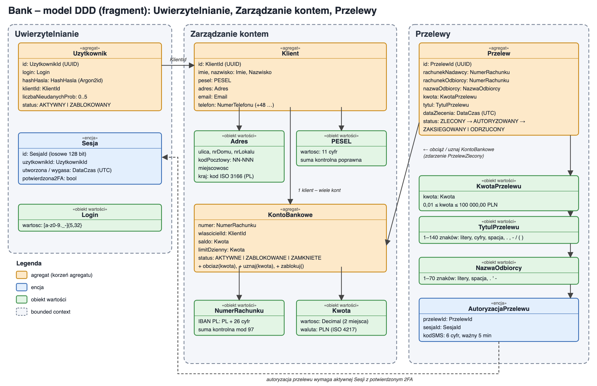

# Zadanie 1 – DDD: fragment aplikacji bankowej

## Opis

Model obejmuje trzy konteksty: Uwierzytelnianie, Zarządzanie kontem i Przelewy. Scenariusz: zalogowany klient zleca przelew krajowy w PLN.
Każdy obiekt jest walidowany przy tworzeniu, więc nie może istnieć w niepoprawnym stanie.

## Model

## Założenia

| Obiekt | Typ | Format / reguły |
|---|---|---|
| Uzytkownik | agregat | login `[a-z0-9._-]{5,32}`, hasło jako hash Argon2id, blokada po 5 błędnych logowaniach |
| Sesja | encja | losowe ID 128 bit, wygasa po 15 min, 2FA wymagane do przelewu |
| Klient | agregat | ID UUID; imię i nazwisko: 1–64 litery, spacja, `'`, `-` |
| Adres | obiekt wartości | kod pocztowy `NN-NNN`, kraj ISO 3166 (PL) |
| PESEL | obiekt wartości | 11 cyfr, poprawna cyfra kontrolna |
| KontoBankowe | agregat | saldo ≥ 0, obciążenia dzienne ≤ limit, zmiana salda tylko przez `obciaz()` / `uznaj()` |
| NumerRachunku | obiekt wartości | IBAN: `PL` + 26 cyfr, suma kontrolna mod 97 |
| Kwota | obiekt wartości | Decimal, 2 miejsca po przecinku, waluta PLN |
| Przelew | agregat | rachunek nadawcy ≠ odbiorcy; status `ZLECONY → AUTORYZOWANY → ZAKSIEGOWANY / ODRZUCONY` |
| KwotaPrzelewu | obiekt wartości | 0,01–100 000,00 PLN |
| TytulPrzelewu | obiekt wartości | 1–140 znaków: litery, cyfry, spacja, `. , - / ( )` |
| NazwaOdbiorcy | obiekt wartości | 1–70 znaków: litery, spacja, `. ' -` |
| AutoryzacjaPrzelewu | encja | kod SMS: 6 cyfr, ważny 5 min, maks. 3 próby |

## Integracja między kontekstami

| Operacja | Konteksty | Warunek |
|---|---|---|
| Powiązanie użytkownika z klientem | Uwierzytelnianie → Zarządzanie kontem | przekazywany jest tylko `KlientId` |
| Autoryzacja przelewu | Przelewy → Uwierzytelnianie | aktywna sesja z 2FA i poprawny kod SMS |
| Obciążenie / uznanie rachunku | Przelewy → Zarządzanie kontem | zdarzenie `PrzelewZlecony`; brak środków lub zablokowane konto → przelew `ODRZUCONY` |
